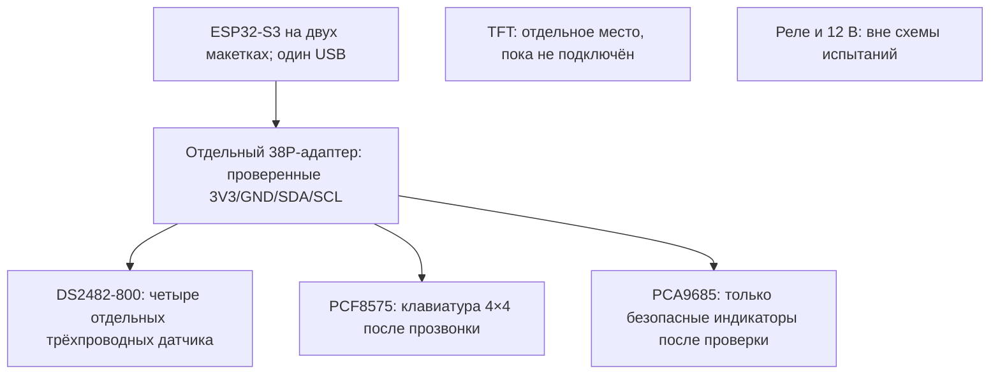

# БУСА-1М с ИИ №001 — временная центральная панель
Дата: 16.10.2026. Редакция 0.1. Статус: проект соединений, НЕ разрешение на включение.
Период: временный стенд до получения центральной платы 44P, ожидаемой владельцем 26.10.2026.
Контроллер: имеющаяся ESP32-S3 N16R8 44P. Прошивка и рабочая v0.6.2-test не изменяются.

## 1. Что установлено и что нет
- Владелец подтвердил наличие S3 N16R8, DS2482S-800, 4 DS18B20, PCF8575, PCA9685, TFT GMT028-05 V1.1, клавиатуры 4x4, релейного модуля 12 В.
- Изучены фото IMG_EADACCDC-E172-4878-8EA5-E3B27686364A, IMG_B15B3D92-3326-4DD3-8575-C676333A09D8, IMG_0DE34C35-11C7-46B7-B73C-C7C78D87D524, IMG_C619566D-BBD4-47AE-9E50-43F07894B8B8 и новое IMG_4A498FE2-ECDF-410E-9218-F756F37AB7A1.
- Видны два USB-C, BOOT/RST, встроенный RGB, два ряда по 22 позиции; компоновка и подписи соответствуют семейству DevKitC-1. Производитель и ревизия конкретной платы НЕ установлены. Официальная плата имеет иной тип USB-разъёмов: её схему нельзя автоматически считать схемой клона.
- На адаптере читается FOR ESP32 TERMINAL ADAPTER; по 19 клемм на стороне. Производитель/ревизия и первичная заводская схема именно этого изделия не установлены. Схемы похожих товаров не доказательство соединений.
- На новом фото S3 размещена между двумя макетками. Электрический контакт, пайка гребёнок и отсутствие замыканий фото не подтверждает.
- Маркировка N16R8 принята по сообщению владельца; память проверяется отдельно при запуске.
- Ни одна цепь пока не прозвонена исполнителем. Ни одно напряжение не измерено.
- Фотографии не копируются в публичный репозиторий; здесь только технические выводы.

## 2. Источники и приоритет
Технический архив: https://docs.google.com/document/d/1MucgvE3ZKaKuvs7Ye8SdKZCUY7OhlaSryMKf4qUIU-w/edit
В дополнениях от 15.10.2026 прямо утверждены GPIO8=SDA, GPIO7=SCL, общая I2C для DS2482S-800, PCF8575 и PCA9685; CH0=T1, CH1=T2, CH2=T3, CH3=T4.
Последнее решение владельца от 16.10.2026 имеет приоритет: N16R8, временные TFT 2.8 и клавиатура 4x4. Старые N32R16V, TFT3.5 и клавиатура5x4 не подставляются вместо имеющихся.
Первичные справочные источники:
- https://documentation.espressif.com/esp-dev-kits/en/latest/esp32s3/esp32-s3-devkitc-1/user_guide_v1.0.html
- https://documentation.espressif.com/esp-dev-kits/en/latest/esp32s3/esp32-s3-devkitc-1/user_guide_v1.1.html
- https://www.analog.com/media/en/technical-documentation/data-sheets/DS2482-800.pdf
- https://www.analog.com/media/en/technical-documentation/data-sheets/DS18B20.pdf
- https://www.nxp.com/docs/en/data-sheet/PCF8575.pdf
- https://www.nxp.com/docs/en/data-sheet/PCA9685.pdf
Даташит микросхемы не подтверждает разводку купленного модуля.

## 3. Механика и питание
S3 НЕ вставлять в адаптер 38P. Адаптер стоит отдельно и соединяется только отдельными проводами.
Закрепить узлы на непроводящем основании; USB доступны, антенна не закрыта проводами/металлом, нет давления на пайку.
Две макетки под S3 допустимы только после проверки отсутствия соединения противоположных выводов и правильной посадки гребёнок.
Снятые/незапаянные штыри не считать надёжным соединением; пайку проверить.
Маркировка рядов макетки не задаёт GPIO. Не назначать номера отверстий по перспективному фото.

Для первого этапа один источник питания — один уже проверенный USB-порт S3. Второй USB, внешний 5 В, 12 В и аварийное питание НЕ подключены.
Шина 3.3 В и GND отдельно подписаны; шину 5 В пока не разводить и не объединять с 3.3 В.
3.3 В на периферию допустимы только после проверки её входов, подтяжек и бюджета регулятора платы. Ток подсветки TFT пока неизвестен — TFT отключён.
Не подавать 5 В на GPIO ESP32-S3. Не питать обесточенные модули через сигнальные линии.
У PCA9685 VCC логики и V+ нагрузки могут быть разными цепями: V+ не подключать до проверки модуля. Это не вход 12 В для логики.
Релейный модуль полностью отсоединён: нет 12 В, IN1–IN4, общей земли, контактов нагрузки.

## 4. Проверяемая распиновка, а не совпадение позиций
Ориентация: компоненты к наблюдателю, антенна сверху, USB снизу.
Ниже справочная последовательность DevKitC-1, видимые подписи фото согласуются с ней; каждый используемый контакт проверить на своей плате.
Левый ряд сверху: 3V3, 3V3, RST, 4, 5, 6, 7, 15, 16, 17, 18, 8, 3, 46, 9, 10, 11, 12, 13, 14, 5V, GND.
Правый ряд сверху: GND, TX, RX, 1, 2, 42, 41, 40, 39, 38, 37, 36, 35, 0, 45, 48, 47, 21, 20, 19, GND, GND.
TX/RX в эталоне — GPIO43/44. Не путать порядковый номер с GPIO.

Адаптер, лицевая сторона как на фото, надпись читается, 3V3 слева сверху:
левые клеммы L01–L19: 3V3, EN, SVP, SVN, P34, P35, P32, P33, P25, P26, P27, P14, P12, GND, P13, SD2, SD3, GND, 5V.
правые R01–R19: GND, P23, P22, TX, RX, P21, GND, P19, P18, P5, P17, P16, P4, P0, P2, P15, SD1, SD0, CLK.
L/R — введённые здесь монтажные метки, НЕ заводские обозначения.
Это чтение надписей, НЕ подтверждённая электрическая карта. Связь каждой клеммы с гнёздами и другими клеммами установить прозвонкой.

## 5. Таблица минимальных соединений
Выбор клемм ниже — проект маршрутизации для проверки, не уже собранная схема. GPIO8/7 взяты из утверждённого архива, остальные GPIO не назначаются.
Перед соединением наклеить новые сетевые имена поверх старых сигнальных подписей.

| Вывод S3 | Назначение | Точка распределения | Продолжение | Условие |
|---|---|---|---|---|
| 3V3, один проверенный контакт | Питание логики | L01, маркировать +3V3 | отдельная шина +3V3 | прозвонить L01 и бюджет питания |
| GND | Общий провод | R01, маркировать GND | отдельная шина GND | проверить все общие GND адаптера |
| GPIO8, подпись 8 | SDA | R06, старая P21, новая SDA/GPIO8 | SDA трёх I2C-модулей | R06 должна быть отдельной сигнальной цепью |
| GPIO7, подпись 7 | SCL | R03, старая P22, новая SCL/GPIO7 | SCL трёх I2C-модулей | R03 отдельна от R06 и питания |
| 5V | Не используется | L19 НЕ подключать | нет | закрыть/пометить |
| Остальные GPIO | Резерв | нет проводов | нет | не назначены |

Провод от S3 можно заводить непосредственно в выбранную винтовую клемму с подходящим оконцеванием; разветвление — через прозвоненное гнездо адаптера/макетную шину. Не зажимать случайный Dupont-штырь ненадёжно и не оставлять оголённую жилу. Не использовать несколько проводов под одним винтом без подтверждения допустимого зажима.
Если карта адаптера не подтверждена, весь адаптер исключить, четыре сети вывести на отдельно прозвоненные группы макетной платы.
На клемму P21 адаптера в этом проекте приходит GPIO8, НЕ GPIO21 S3. P22 адаптера НЕ GPIO22 S3.

### Резерв/ограничения
GPIO35–37 для N16R8 с Octal PSRAM не использовать. GPIO19/20 оставить для native USB; GPIO43/44 — для UART.
GPIO0,3,45,46 не нагружать внешними цепями запуска; GPIO46 также не выбирать как выход.
GPIO38/48 оставить свободными до определения ревизии встроенного RGB.
RST/EN — только штатная кнопка, без проводов на EN адаптера.
Остальные доступные GPIO пока свободны. SPI-дисплей требует отдельного подтверждённого назначения SCK/MOSI/CS/DC/RST и при необходимости MISO; подсветка не питается от GPIO без проверки.

## 6. Периферия: соединения по именам цепей
| Узел | Питание/интерфейс | Проверка до монтажа |
|---|---|---|
| DS2482-800 | VCC=3.3 В, GND, SDA, SCL | реальная маркировка, адресные перемычки, подтяжки |
| PCF8575 | питание логики 3.3 В, GND, SDA, SCL | проверить VCC/VDD модуля OPEN-SMART, A0–A2; INT пока свободен |
| PCA9685 | VCC логики 3.3 В, GND, SDA, SCL | V+ отдельно; адрес, OE и подтяжки проверить; выходы пока без нагрузки |
| DS18B20 T1 | VDD=3.3 В, GND, DQ→CH0 | вода |
| DS18B20 T2 | VDD=3.3 В, GND, DQ→CH1 | колонна |
| DS18B20 T3 | VDD=3.3 В, GND, DQ→CH2 | куб |
| DS18B20 T4 | VDD=3.3 В, GND, DQ→CH3 | верх |
| TFT GMT028-05 V1.1 | пока отключён | обе стороны, контроллер, VCC/LED, логика и ток; не объявлять ILI9341 по диагонали |
| Клавиатура 4x4 | 8 линий к PCF8575, питание отдельно не требуется для пассивной матрицы | прозвонить строки/столбцы, затем назначить P00…; порядок шлейфа неизвестен |
| LED | после проверки через индивидуальные резисторы | полярность, ток, выходы PCA9685; не подключать LED без резистора |
| Реле 12 В | полностью отключено | отдельный последующий аудит |

DS18B20 подключать трёхпроводно, без паразитного питания. Цвета проводов и номера JST-XH не гарантируют VDD/DQ/GND: составить карту каждого разъёма с указанием стороны защёлки. Записать ROM каждого датчика.
CH4–CH7 DS2482 оставить свободными. Не объединять DATA четырёх каналов.
DS2482 имеет внутренние механизмы подтяжки; не добавлять автоматически по 4.7 кОм на канал без проверки модуля и требований даташита.
I2C подтяжки только к 3.3 В. Измерить суммарное сопротивление параллельных подтяжек; не добавлять ещё один комплект наугад. Сначала короткие провода и тест 100 кГц как испытательная настройка, не утверждение финальной частоты.
Адреса установить по перемычкам/даташиту и подтвердить сканированием: ожидаемые диапазоны DS2482-800 0x18–0x1B, PCF8575 0x20–0x27; PCA9685 зависит от A0–A5, часто 0x40, возможен ответ All Call 0x70. Не выдавать ожидания за обнаруженные устройства.

## 7. Размещение (функциональное, не масштаб и не монтажная распиновка)

Температурный узел закрепить отдельно, разгрузить кабели датчиков; провода I2C короткие.
TFT и клавиатура спереди, контроллер/распределитель сзади на непроводящем основании.
Силовых соединений и внешних блоков на панели нет.

## 8. Последовательная проверка БЕЗ питания
1. Отключить оба USB, любые БП, все модули и нагрузки. Извлечь S3 из адаптера, если вставлена.
2. Сфотографировать обе стороны S3 и адаптера перпендикулярно; записать модель/ревизию и маркировку регулятора. Осмотреть пайку.
3. На пустом адаптере прозвонить каждую используемую клемму до соответствующего гнезда; проверить соседние клеммы и обе полосы гнёзд. Отдельно установить, какие GND/питания соединены внутри.
4. На пустых макетках проверить группы по 5 контактов, разрыв центрального канала и разрывы длинных шин. Полосы с +/− сами напряжение не задают.
5. Зафиксировать S3; убедиться, что противоположные ножки не попадают в одну соединённую группу. Не прозванивать через установленную S3 вместо проверки пустой макетки.
6. Установить только GND, +3V3, SDA, SCL по таблице; каждый провод проверить от конца до конца и промаркировать с двух сторон.
7. Проверить отсутствие ошибочного соединения +3V3–GND, +3V3–5V, SDA–SCL и сигнал–чужая шина. На собранной электронике конденсаторы/защитные диоды влияют на показания: один звуковой сигнал не заменяет измерение сопротивления/разбор цепи. При устойчивом низком сопротивлении не подавать питание.
8. Отдельно проверить подтяжки каждого модуля и их питание. Проверить распиновку датчиков/разъёмов и отсутствие перемычек.
9. Записать измеренные результаты, фото и подпись исполнителя в журнал. Все пункты сейчас НЕ ВЫПОЛНЕНЫ.

## 9. Следующие испытания — отдельными этапами
A. Только S3, один USB, периферия снята: чтение лога, идентификация памяти/PSRAM, измерение 3.3 В. Не менять рабочую v0.6.2-test автоматически.
B. После проверки питания — по одному модулю I2C; каждое добавление только при снятом питании. Записать адрес и напряжение покоя SDA/SCL. Не проверять на GPIO сигнал 5 В.
C. DS2482, сначала один датчик, затем четыре: ROM, CRC, действительное завершение преобразования, свежесть и отключение датчика. Ошибка отображается как нет данных, а не 0 °C; 85 °C не отбрасывать без проверки завершения преобразования.
D. Клавиатура: получить реальную матрицу, антидребезг, удержание и одновременные нажатия.
E. TFT только после снятия блокирующих вопросов и проверки питания; отдельно тест изображения.
F. Wi-Fi iPhone12: точное SSID вводится локально, пароль в GitHub не сохранять. Отдельно проверять соединение Wi-Fi, локальную связь приложения и интернет — это разные проверки.
G. Автоматика K1–K4: сначала программные состояния, затем отдельные безопасные LED. Не считать каналы PCA9685 физическими реле. Отображение LED на каналы согласовать, не занимать самовольно CH0–CH10 штатной индикации.
H. Реальные реле, 12 В, нагреватели, контактор, внешние блоки и 220 В НЕ ПОДКЛЮЧАТЬ. Никаких импульсных тестов IN1–IN4.

В исходной ветке LAB не содержит полного управления датчиками/Wi-Fi/автоматикой. Эта документация его не добавляет.
Согласованные пороги, задержки и гистерезис не изменяются и не придумываются.
Отсутствие управляющих 12 В, по описанию владельца, оставляет внешний блок работающим: отключённые реле не равны аварийному отключению системы.

## 10. Что нужно для разрешения следующего этапа
- Чёткие фото обратной стороны и маркировки S3 и 38P-адаптера.
- Результаты прозвонки четырёх выбранных сетей и всех возможных общих перемычек.
- Фото обеих сторон DS2482, PCF8575, PCA9685, TFT, особенно питание/адресные перемычки.
- Проверенные контакты датчиков и матрица клавиатуры.
- Проверка регулятора/тока питания перед совместным включением и подсветкой.
Наличие мультиметра необходимо; если его нет, сборку с питанием отложить.

Документ разрешает подготовку и проверку без питания, НЕ подтверждает готовность к включению.
